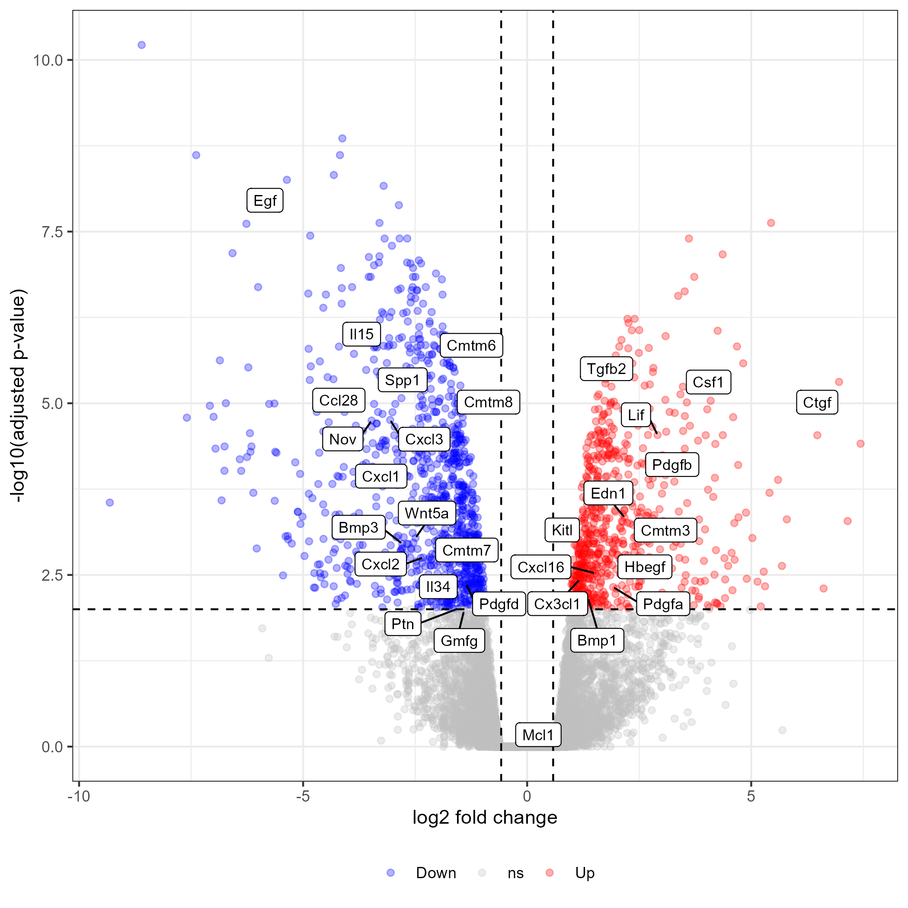
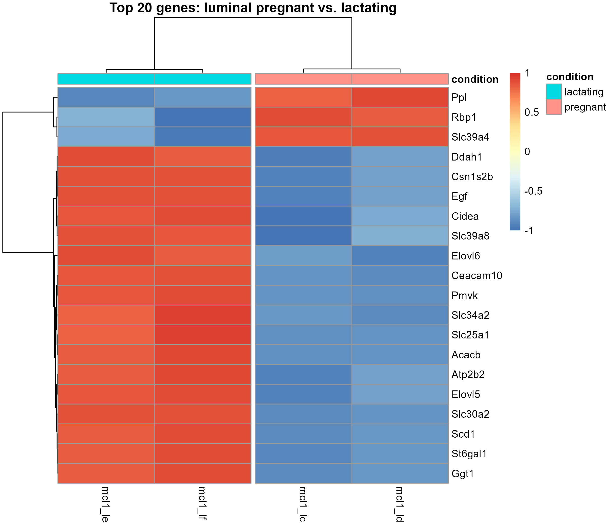

## The Data

This exercise uses RNA-seq data from [FU et al. 2015, *Nature Cell Biology*](https://www.nature.com/articles/ncb3117). The data compares gene expression in luminal cells of pregnant versus lactating mice. You can download the data from [this Zenodo repository](https://zenodo.org/records/2529926) and you can have a look at [this Galaxy tutorial](https://training.galaxyproject.org/training-material/topics/transcriptomics/tutorials/rna-seq-viz-with-heatmap2/tutorial.html) for some ideas on how to get started.

The dataset consists of three files (no file extension, but tab separated):

1.  `limma-voom_luminalpregnant-luminallactate`: Differential expression results, including logFC, AveExpr, t-statistic, p-value and adjusted p-value for all genes
2.  `limma-voom_normalised_counts`: Normalized counts (already on a log2 scale) for all genes across 12 samples
3.  `heatmap_genes` A list of interesting genes to analyze (used in Figure 6b of the paper)

The 12 samples are basal and luminal cells from virgin, pregnant and lactating mice (2 replicates each). The sample names don't tell you which group a sample belongs to, so here is the information (sample names as they look after `janitor::clean_names()`):

| Sample | Cell type | Condition |
|---|---|---|
| `mcl1_dg`, `mcl1_dh` | basal | virgin |
| `mcl1_di`, `mcl1_dj` | basal | pregnant |
| `mcl1_dk`, `mcl1_dl` | basal | lactating |
| `mcl1_la`, `mcl1_lb` | luminal | virgin |
| `mcl1_lc`, `mcl1_ld` | luminal | pregnant |
| `mcl1_le`, `mcl1_lf` | luminal | lactating |

The differential expression results compare luminal pregnant (`lc`, `ld`) with luminal lactating (`le`, `lf`) samples. A positive logFC means higher expression in pregnant, a negative logFC means higher expression in lactating.

To simplify the analysis you can consider the following:

- Read the files using `read_tsv()`
- Clean column names with `janitor::clean_names()` to make them easier to work with
- Combine the differential expression results and the normalized counts using `left_join()` (they share the columns `entrezid`, `symbol` and `genename`)
- Create a table with the sample information from above. You will need it for the heatmap and the PCA.

It is a bit tricky to read in the data correctly, so if you need a hint, you can
unfold the code below

```{r}
#| echo: true
#| eval: false
#| code-fold: true
#| code-summary: "Expand to see how to read the data"

# Read all the files and clean the column names
# ADJUST the paths to where you saved the files
heatmap_genes <- read_tsv("data/heatmap_genes")
DE_results <- read_tsv("data/limma-voom_luminalpregnant-luminallactate")
DE_results <- janitor::clean_names(DE_results)
normalized_counts <- read_tsv("data/limma-voom_normalised_counts")
normalized_counts <- janitor::clean_names(normalized_counts)

# combine tables
genes <- left_join(
  DE_results,
  normalized_counts,
  by = c("entrezid", "symbol", "genename")
) |>
  select(-entrezid, -genename)
```

```{r}
#| echo: true
#| eval: false
#| code-fold: true
#| code-summary: "Expand to see how to create the sample table"

sample_table <- tibble(
  sample = c(
    "mcl1_dg", "mcl1_dh", "mcl1_di", "mcl1_dj", "mcl1_dk", "mcl1_dl",
    "mcl1_la", "mcl1_lb", "mcl1_lc", "mcl1_ld", "mcl1_le", "mcl1_lf"
  ),
  cell_type = rep(c("basal", "luminal"), each = 6),
  condition = rep(c("virgin", "pregnant", "lactating"), each = 2, times = 2)
)
```

## Questions

#### What are the top 20 most significantly differentially expressed genes?

-   Use the same thresholds as the Galaxy tutorial: adjusted p-value < 0.01 and absolute logFC > 0.58 (that's a 1.5-fold change)
-   Tip: Filter the genes based on adjusted p-value and logFC, then order by adjusted p-value with `arrange()` and keep the first 20 rows with `head()`.

#### Create a heatmap of the top 20 genes. How do the expression patterns differ between pregnant and lactating samples?

-   Checkout the `pheatmap` package for creating heatmaps.
-   `pheatmap()` needs a matrix with only the sample columns and the gene names as rownames. Check out `column_to_rownames()` and `as.matrix()`.
-   Use `scale = "row"` so that the colors show if a gene is higher or lower than its average.
-   First make a heatmap with all 12 samples. Then make one with only the 4 samples that were compared (`lc`, `ld`, `le`, `lf`).

#### Create a volcano plot to visualize the differential expression results. How many genes are significantly up-regulated or down-regulated?

-   First create a simple volcano plot: logFC on the x-axis and -log10 of the adjusted p-value on the y-axis
-   Then add a new column with `case_when()` that says if a gene is up, down or not significant (use the thresholds from above). Use this column for the color. With `count()` you can count how many genes are in each category.
-   Optional: label the top 10 genes with `ggrepel::geom_label_repel()`
-   Check my R script and/or [this tutorial](https://erikaduan.github.io/posts/2021-01-02-volcano-plots-with-ggplot2/) on how
to create a volcano plot with ggplot

#### Perform a Principal Component Analysis (PCA) on the top 20 genes. What can you conclude about the separation of the samples?

-   Tip: Use `prcomp()` for PCA and `factoextra::fviz_pca_ind()` for visualization.
-   `prcomp()` needs the samples in rows and the genes in columns. You can use the matrix from the heatmap and turn it around with `t()`.
-   Color the points by group (cell type and condition) with the `col.ind` argument of `fviz_pca_ind()`.

#### Bonus: What about the genes of interest?

-   Create a heatmap of the genes in `heatmap_genes` and label them in your volcano plot.
-   You can reuse most of your code from above, you only need to filter for different genes.

## Useful Functions

To complete these tasks, you may find the following R functions and packages helpful:

1.  Data manipulation:
    - `janitor::clean_names()`: Clean column names
    - `left_join()`: Combine data frames
    - `tibble()` and `rep()`: Create the sample table
    - `case_when()`: Create categories (e.g. up, down, not significant)
    - `count()`: Count the number of rows per category
2.  Statistical analysis:
    - `prcomp()`: Perform Principal Component Analysis
    - `t()`: Transpose a matrix (rows become columns)
3.  Visualization:
    - `pheatmap::pheatmap()`: Create heatmaps (needs a matrix, so you need to reshape your data first into a matrix)
    - `ggrepel::geom_label_repel()`: Add non-overlapping labels to plots
    - `factoextra::fviz_pca_ind()`: Visualize PCA results
4.  Other useful functions:
    - `column_to_rownames()`: Use a column as rownames (needed for `pheatmap`)
    - `as.matrix()`: Convert data frames to matrices

## Example analysis

:::{.columns}

:::{.column width="50%"}


:::

:::{.column width="50%"}



:::

:::


[<i class="bi bi-download"></i> Download solution script](../R/byod/solutions_for_my_datasets/dnaseq_data.R){.btn .btn-outline-secondary download="solution_for_rna_data.R"}
