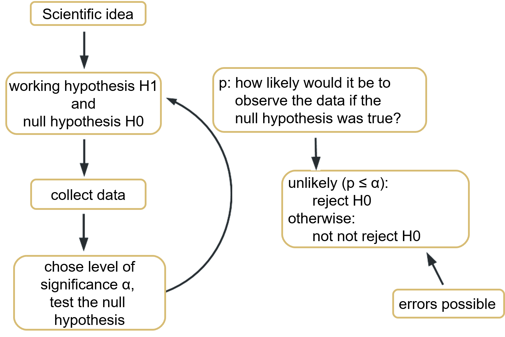

```{r}
#| label: setup
#| include: false
#| cache: false
library(dplyr)
library(ggplot2)
library(tidyr)
theme_set(theme_grey(base_size = 16))
options(scipen = 0)
```

## General approach

Question → inspect the data → run a suitable test → interpret → plot

{width="55%"}

. . .

The p-value tells you how much **evidence** there is for a difference, not how **large** the difference is: always report the group means too.

:::{.aside}

Please note the discussion about p-values as a basis for binary decisions.
  See e.g. [here](https://www.nature.com/articles/s41592-019-0470-3) or [here](https://www.nature.com/articles/d41586-019-00857-9) as a starting point

:::

# Inspect the data {.inverse}

## The data: iris

Sepal width (in cm) of 50 flowers from three iris species

```{r}
#| flourish:
#|   - target: "as_tibble"
flowers <- as_tibble(iris) |>
  select(sepal_width = Sepal.Width, species = Species)
flowers
```

## First look at the data

:::{.columns}

:::{.column width="45%"}

```{r}
flowers |>
  group_by(species) |>
  summarize(
    n = n(),
    mean = mean(sepal_width),
    sd = sd(sepal_width)
  )
```

:::

:::{.column width="55%"}

```{r}
#| fig-height: 5.5
#| code-fold: true
#| code-summary: "Code for the boxplot"
iris_boxplot <- ggplot(
  flowers,
  aes(x = species, y = sepal_width)
) +
  geom_boxplot() +
  geom_point(
    position = position_jitter(width = 0.08, height = 0, seed = 123),
    alpha = 0.6
  ) +
  labs(x = "Species", y = "Sepal width (cm)")
iris_boxplot
```

:::

:::

## Prepare the group vectors

Most test functions take the values of each group as a **vector**

```{r}
setosa <- filter(flowers, species == "setosa")$sepal_width
versicolor <- filter(flowers, species == "versicolor")$sepal_width
virginica <- filter(flowers, species == "virginica")$sepal_width
```

. . .

```{r}
versicolor
```

## Shapiro-Wilk test

$H_0$: The data come from a normal distribution

```{r}
shapiro.test(versicolor)
shapiro.test(setosa)
shapiro.test(virginica)
```

- A **large p-value**: no evidence against normality, can not reject $H_0$
- With **large samples**, even tiny deviations give small p-values
- Always look at the data as well

## Check with QQ-plots

Points should roughly follow the line. Look at the **tails** and at **unusual observations**.

:::{.columns}

:::{.column width="33%"}

```{r}
#| fig-width: 4
#| fig-height: 4
ggpubr::ggqqplot(setosa)
```

:::

:::{.column width="33%"}

```{r}
#| fig-width: 4
#| fig-height: 4
ggpubr::ggqqplot(versicolor)
```

:::

:::{.column width="33%"}

```{r}
#| fig-width: 4
#| fig-height: 4
ggpubr::ggqqplot(virginica)
```

:::

:::

. . .

All three species: no clear deviation from normality

## Which comparison are we making?

:::{.columns}

:::{.column width="50%"}

**Welch's t-test**

:::{.nonincremental}

- Compares the **means** of two groups
- Works with equal and unequal variances
- Suitable for roughly normal data, or for larger samples

:::

:::

:::{.column width="50%"}

**Wilcoxon rank-sum test**

:::{.nonincremental}

- Compares **ranks**: does one group tend to have larger values?
- Useful for
  - ordinal data (e.g. scores from 1 to 5)
  - small, strongly skewed samples
  - samples with extreme outliers

:::

:::

:::

. . .

Choose the test based on your **question** and a **look at the data**, not on a single Shapiro-Wilk p-value.

# Compare two groups {.inverse}

## Compare two means: Welch's t-test

$H_0$: The means of the two groups do not differ

```{r}
t.test(versicolor, virginica)
```

- p-value: How likely is it to observe a difference this high if the means were equal?
- Reject $H_0$

. . .

Mean sepal width was **0.20 cm smaller** in *I. versicolor* than in *I. virginica* (Welch's t(97.93) = -3.21, p = 0.0018).

## Wilcoxon rank-sum test

$H_0$: Neither group tends to have larger values than the other

```{r}
wilcox.test(versicolor, virginica)
```


- All values are ranked from smallest to largest
- The test compares the ranks of the two groups
- **Demonstration only:** the iris data don't need a rank-based test, t-test was fine here


## Paired observations

In `sleep`, the **same 10 people** received two drugs (`extra`: extra sleep in hours)

:::{.columns}

:::{.column width="45%"}

```{r}
sleep_paired <- sleep |>
  pivot_wider(
    names_from = group,
    names_prefix = "drug_",
    values_from = extra
  )
sleep_paired
```

:::

:::{.column width="55%"}

```{r}
#| flourish:
#|   - target: "paired = TRUE"
t.test(
  sleep_paired$drug_1,
  sleep_paired$drug_2,
  paired = TRUE
)
```

:::{.nonincremental}

- One row per person: the measurements stay matched
- Also: `wilcox.test(..., paired = TRUE)`

:::

:::

:::

# Plot test results {.inverse}

## Plot two species

Create a table with only the two species that we compared

```{r}
#| output-location: column
#| fig-height: 5.5
flowers_two_species <- filter(
  flowers,
  species %in% c("versicolor", "virginica")
)

ggplot(
  flowers_two_species,
  aes(x = species, y = sepal_width)
) +
  geom_boxplot() +
  labs(
    x = "Species",
    y = "Sepal width (cm)"
  )
```

## Add a test with `geom_signif()`

The [`ggsignif`](https://const-ae.github.io/ggsignif/) package adds significance levels to a ggplot

```{r}
#| output-location: column
#| fig-height: 5.5
#| flourish:
#|   - target: "geom_signif("
#|   - target: 'test = "t.test",'
#|   - target: "map_signif_level = TRUE"
# install.packages("ggsignif")
library(ggsignif)

ggplot(
  flowers_two_species,
  aes(x = species, y = sepal_width)
) +
  geom_boxplot() +
  geom_signif(
    comparisons = list(
      c("versicolor", "virginica")
    ),
    test = "t.test",
    map_signif_level = TRUE
  )
```

:::{.nonincremental}

- `test = "t.test"`: Welch's test (the default is a Wilcoxon test)
- `map_signif_level = TRUE`: stars, `FALSE`: p-value

:::

# Compare three groups {.inverse}

## What changes with three species?

Three pairs: setosa vs. versicolor, setosa vs. virginica, versicolor vs. virginica

. . .

Chance of at least one false positive, if there are no real differences (independent tests, each at the 5% level):

| Number of tests | Chance of at least one false positive |
|---:|---:|
| 1 | 5% |
| 3 | 14.3% |
| 10 | 40.1% |

. . .

A 5% threshold for each test does not give 5% protection across several tests → **adjust the p-values**

:::{.aside}

The iris tests share data and are not independent, so 14.3% is not their exact error rate.

:::

## Pairwise comparisons in R

```{r}
#| flourish:
#|   - target: "pool.sd = FALSE"
pairwise_results <- pairwise.t.test(
  flowers$sepal_width,
  flowers$species,
  pool.sd = FALSE
)
pairwise_results
```

:::{.nonincremental}

- `pool.sd = FALSE`: a Welch's test for each pair
- The p-values are already adjusted (Holm method is the default)
- Read row and column: virginica vs. versicolor, p = 0.0018
- Use the group summary from before for the means
- Rank-based alternative: `pairwise.wilcox.test()`

:::

## Prepare the plot annotations

Extract the adjusted p-values with `p["row", "column"]`:

```{r}
p <- pairwise_results$p.value

comparisons <- list(
  c("setosa", "versicolor"),
  c("setosa", "virginica"),
  c("versicolor", "virginica")
)

adjusted_p <- c(
  p["versicolor", "setosa"], # setosa vs. versicolor
  p["virginica", "setosa"], # setosa vs. virginica
  p["virginica", "versicolor"] # versicolor vs. virginica
)

p_labels <- paste("p =", format.pval(adjusted_p, digits = 2))
p_labels
```

## Plot all three comparisons

```{r}
#| output-location: column
#| fig-height: 5.5
#| flourish:
#|   - target: "annotations = p_labels,"
#|   - target: "step_increase = 0.1,"
test_annotations <- geom_signif(
  comparisons = comparisons,
  annotations = p_labels,
  step_increase = 0.1,
  tip_length = 0.02
)

iris_boxplot +
  test_annotations +
  labs(
    caption = "Holm-adjusted Welch's tests"
  )
```

:::{.nonincremental}

- With `annotations`, `geom_signif()` does not run new tests: it shows our adjusted p-values
- `step_increase`: stack the brackets

:::

## Plot means with `stat_summary()`

```{r}
#| output-location: column
#| fig-height: 5.5
#| flourish:
#|   - target: "stat_summary()"
ggplot(
  flowers,
  aes(x = species, y = sepal_width)
) +
  stat_summary() +
  labs(
    x = "Species",
    y = "Sepal width (cm)"
  )
```

:::{.nonincremental}

- By default, `stat_summary()` shows the mean ± standard error (SE)

:::

## Style means and error bars

```{r}
#| output-location: column
#| fig-height: 5.5
ggplot(
  flowers,
  aes(x = species, y = sepal_width)
) +
  stat_summary(
    fun.data = mean_se,
    geom = "errorbar",
    width = 0.15
  ) +
  stat_summary(
    fun = mean,
    geom = "point",
    color = "#28a87d",
    size = 4
  )
```

:::{.nonincremental}

- `fun.data` for error bars, `fun` for points
- SE bars show the uncertainty of each mean. 

:::

## Barplots with error bars

```{r}
#| output-location: column
#| fig-height: 5.5
#| flourish:
#|   - target: 'geom = "bar",'
iris_bars <- ggplot(
  flowers,
  aes(x = species, y = sepal_width)
) +
  stat_summary(
    fun = mean,
    geom = "bar",
    fill = "#28a87d",
    width = 0.65
  ) +
  stat_summary(
    fun.data = mean_se,
    geom = "errorbar",
    width = 0.15
  ) +
  labs(x = "Species", y = "Sepal width (cm)")
iris_bars
```

## Reuse the test annotations

The same adjusted p-values work for any plot type

```{r}
#| fig-width: 8
#| fig-height: 4.5
#| flourish:
#|   - target: "test_annotations"
iris_bars +
  test_annotations +
  labs(caption = "Mean ± SE; Holm-adjusted Welch's tests")
```

# Now you {.inverse}

[Task (45 min)]{.highlight-blue}<br>

[Statistical tests with penguins]{.big-text}

**Find the task description [here](https://selinazitrone.github.io/intro-r-data-analysis/sessions/tasks/tests-task.html)**
